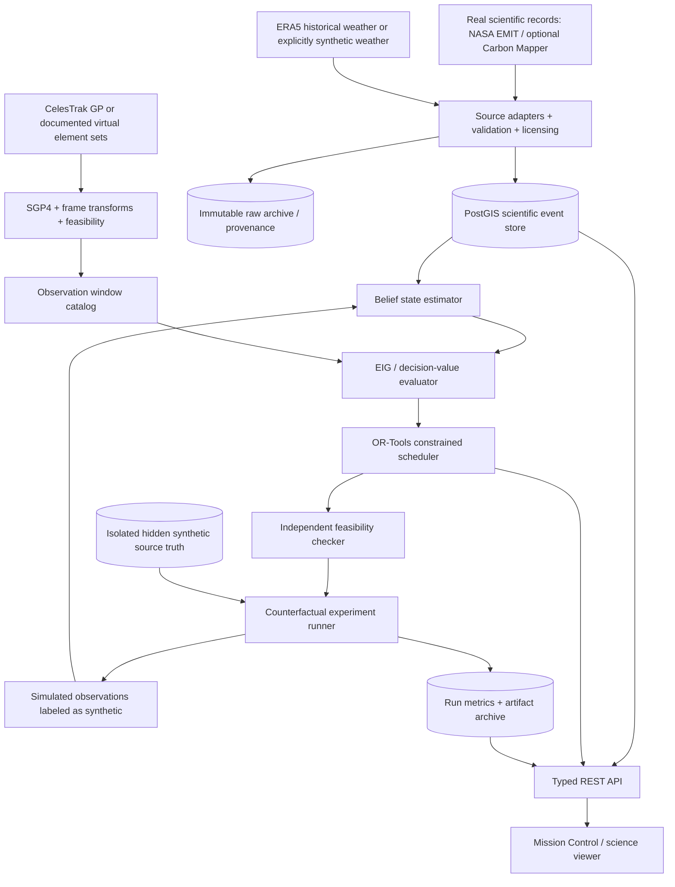

# AETHER — Product Requirements Document

**Autonomous Earth Observation & Climate Intelligence System**  
**Domain:** Aerospace engineering × sustainability × remote sensing × Bayesian inference × autonomous planning  
**Document:** Technical PRD / research and implementation specification  
**Version:** 1.0 · **Status:** Proposed; not an implemented or validated system  
**Prepared:** 17 October 2026  
**Primary delivery:** Reproducible hackathon research prototype; extensible scientific testbed  
**Source concept:** User-provided *AETHER — Autonomous Earth Observation & Climate Intelligence System* [C00]

> **Evidence legend:** **[E] Established external fact** supported by the Citations Board; **[D] design decision** proposed by this PRD; **[H] hypothesis** requiring evaluation; **[T] target** to be tested rather than an achieved result; **[A] assumption** requiring documentation, sensitivity testing, or confirmation. Citation IDs in square brackets refer to the final **Citations Board**. No claim of NASA sponsorship, operational control, measured performance, or verified methane mitigation is made.

---

## 0. Executive decision and non-negotiable principles

**Product statement.** AETHER is an experimental, evidence-aware Earth-observation mission planner. It ingests real, traceable methane-plume observations; models uncertainty about whether a source is currently emitting and how strongly; computes physically feasible observation opportunities for explicitly **virtual, taskable** satellites; selects observations using constrained optimization and expected information gain; simulates acquisition; assimilates the synthetic result; and replans. It compares that policy with fair baseline schedulers under the **same hidden environmental history and spacecraft restrictions**. [C00]

**Key research hypothesis [H-01].** An adaptive planner incorporating emission persistence, measurement quality, uncertainty, and orbital/spacecraft constraints produces **more decision-relevant evidence per constrained observation opportunity** than arrival-order, largest-emitter-first, and static-priority scheduling. The hypothesis is falsifiable; improvement is *not* presumed.

**Product boundaries:**

1. **Real measurement ≠ simulated measurement.** Distinct provenance classes are mandatory in storage, API, exports, maps, metrics, and screenshots. Synthetic measurements must never silently become scientific claims.
2. **Orbital visibility ≠ mission commandability.** An ISS-mounted EMIT instrument cannot be treated as a freely steerable imaging spacecraft. Historical real-mission replay and virtual taskable-satellite planning are separate modes. EMIT is installed on the ISS, and its sensing is tied to actual mission geometry. [S01, S02]
3. **Plume enhancement ≠ instantaneous source flux.** A concentration enhancement raster, integrated mass enhancement, and kg CH₄/h emission rate are different quantities. Units, estimation method, wind assumptions, uncertainties, and source-product versions must survive ingestion. [S01, S07]
4. **Non-detection ≠ zero emissions.** Preserve distinctions among **detected**, **valid non-detection**, **invalid acquisition**, **not observed**, and **unknown/missing record**. Non-detection updates require a sensor-specific likelihood. [S08]
5. **A schedule ≠ an actual detection.** The simulator must generate possible outcomes probabilistically; it must not infer a detected plume merely because a spacecraft was assigned a pass.
6. **Identifying a likely source ≠ accusing a facility.** Source associations remain probabilistic and explainable. Do not publish assertions of culpability from proximity alone.
7. **Better evidence ≠ verified emissions reductions.** The platform may support follow-up and interpretation; real-world mitigation requires independent attribution and measurement.
8. **Transparent, reproducible computation.** Every published benchmark contains configurations, code version, input hashes, seeds, model versions, optimizer status, failure counts, and limitations.
9. **Research credibility over appearance.** A real optimizer, orbital engine, posterior updater, and fair benchmark take priority over 3D effects, animations, or unvalidated “AI” labels.

### 0.1 Why methane and why AETHER

Methane has substantial climate impact over the near term: the US EPA reports a 100-year global-warming potential of approximately **27–30** relative to CO₂, depending on the accounting framework. This does **not** mean AETHER itself reduces emissions. [S11] NASA EMIT publishes a versioned methane plume product with geospatial outputs, emission estimates *when estimation criteria are met*, and uncertainty information. [S01] Carbon Mapper provides programmatic plume/source access with data-use conditions and rate limits. [S03] The scientific gap AETHER addresses is not discovering methane or inventing space autonomy; it is rigorously studying **which evidence to collect next**. Satellite autonomous-science and mission-planning research already exists, including NASA EO-1. [S09]

### 0.2 Target research outputs

- Working end-to-end closed loop: **ingest → scientific state → feasible windows → candidate utilities → optimized schedule → simulated acquisition → Bayesian update → replan**.
- Reusable, typed experiment configuration; real-observation provenance and uncertainty viewer.
- Feasibility model with documented taskable instrument assumptions and a validation report.
- Comparative benchmark with at least two methods for hackathon MVP and four methods for full evaluation.
- Human-readable per-observation justification and audit trail.
- Complete limitations, scientific integrity statement, and source/reproduction links.

## 1. Problem definition, opportunity, and research novelty

### 1.1 Actual problem

Satellite measurements are spatially and temporally sparse, can be compromised by atmosphere and geometry, and vary in spectral sensitivity and access constraints. A plume observation leaves unresolved whether release is persistent, how much was emitted over time, what produced it, and which possible revisit would be most useful. Optimizing merely for the largest apparent rate ignores uncertainty and availability; optimizing merely for orbital proximity ignores instrument capability, power, storage, attitude, and acquisition quality. [C00, S01, S07, S08]

### 1.2 Proposed contribution

An **uncertainty-aware, closed-loop, physically constrained planner** that computes marginal value from a predictive observation model, uses a joint belief about activity and emission rate, and updates itself after new simulated evidence. Novelty is a **research claim to benchmark against prior work**, not a granted patent or first-ever discovery. Related fields already include onboard autonomy, probabilistic methane persistence, multi-sensor retrieval, and optimization. [S08, S09, S14]

### 1.3 Precise research questions

- **RQ1:** Does AETHER lower the average source-state uncertainty faster than fair baselines per observation and per simulated day?
- **RQ2:** Does improved information yield translate into better **out-of-sample decisions** (correctly ranking unresolved high-impact sources, corroboration latency, posterior flux error), rather than only the entropy metric it directly optimizes?
- **RQ3:** How does it perform when its cloud, sensor-sensitivity, intermittency, or wind models are wrong?
- **RQ4:** What accuracy/runtime tradeoff results from candidate pruning, temporal discretization, solver time limits, and rolling-horizon frequency?
- **RQ5:** Can an independent user trace each recommendation to observation evidence, assumptions, feasibility constraints, and solver output?

### 1.4 Explicit non-goals

- No spacecraft telemetry, uplink, tasking credentials, mission-command software, attitude-control actuation, or operational NASA integration.
- No claim of universal source detection or complete global methane coverage.
- No claim to reconstruct exact instantaneous flux from column enhancement without wind/segmentation calibration.
- No automatic law-enforcement, public shaming, regulatory enforcement, or company violation determination.
- No automatic repair verification from a single clear non-detection.
- No proprietary satellite dataset access without explicit permission.
- No model trained on synthetic truth and then marketed as validated on independent real ground truth.

## 2. Users, jobs-to-be-done, and product surfaces

| Persona | Primary job | Required evidence | Access and cautions |
|---|---|---|---|
| Earth-observation scientist | Compare adaptive acquisition research methods | source observations, posterior, assumptions, reproducible benchmarks | research workspace; provenance-first |
| Mission planning researcher | Evaluate resource-constrained satellite schedules | orbital windows, pointing, storage, resource accounting, solver traces | **simulated** mission mode clearly marked |
| Remote-sensing / atmospheric analyst | Review plume and temporal uncertainty | quality flags, flux distribution, meteorology, likelihood model | never equate a gap with zero |
| Environmental investigator | Prioritize sources for independent follow-up | corroboration needs, spatial evidence, uncertainty | attribution caveats and no enforcement conclusions |
| Public / reviewer / hackathon judge | Understand what happened and why an observation was selected | accessible visual story, method comparison, disclaimers | read-only, no unsupported reduction claims |
| Developer / evaluator | Reproduce run and verify scientific integrity | open schema, scripts, tests, seeds, hashes | environment setup and export |

**P0 public surfaces:** (1) Mission Control overview; (2) map/observation history; (3) virtual orbit/window view; (4) planner comparison; (5) evidence/uncertainty panel; (6) experiment configuration and reproducibility summary. **P1:** batch dataset manager, research notebook export, multi-region comparisons, authenticated collaborative workspaces. **P2:** multisensor model research, probabilistic source attribution, real mission partnerships under authorization.

## 3. Scope, milestones, and release gates

### 3.1 Hackathon MVP / P0

**Recommended bounded experiment [D]:** one geography; 10–20 **selected historical real plumes** for scientific context, plus a separately defined synthetic source population for counterfactual runs; 1–2 **virtual taskable** satellites; one sensor-response model; a 72-hour simulated planning horizon; at least **two** fair schedulers (static or largest-first versus adaptive); at least one posterior update and resulting authentic change in schedule. [C00]

**P0 mandatory:**

- Real plume ingestion with acquisition timestamp, geometry, provider/product identity, rate *if available*, uncertainty *if available*, and quality/absence indicators.
- Virtual orbital window generation using a reproducible trajectory, frame conversion, geometry, and sensor profile.
- Explicit feasibility rejection reasons and resource accounting; disallow invalid acquisitions.
- Numerical belief update, sensor-specific detection probability, correct treatment of valid non-detection and no-data.
- OR-Tools constrained selection; logged status and objective components; re-solve on observation/weather updates.
- Deterministic simulation with separate hidden ground truth and a fixed seed; fair baseline replay.
- Objective metric comparison and visible labels distinguishing measured, inferred, predicted, and simulated.

**P0 exclusions:** uncalibrated universal plume retrieval, real cloud forecasting advertised as operational, automated facility blame, real-satellite command scheduling, POMDP, satellite downlink physics with unverified infrastructure, and claims of measured climate impact.

### 3.2 Research v1 / P1

Expand to the source concept's **illustrative** benchmark of 50–100 virtual emitting sources, 3 virtual heterogeneous spacecraft, 72-hour horizon, 4 competing strategies, multiple simulation seeds, sensitivity/ablation studies, stronger sensor calibration and multiple real-data geographic cases. **These are benchmark design parameters, not executed results.** [C00]

### 3.3 Scientific v2 / P2

Optional radiance/enhancement-to-flux reconstruction, calibrated multisensor probability-of-detection curves, more complete atmospheric transport and correlated errors, probabilistic source attribution, stochastic scheduling/robust optimization, belief-state/POMDP planning, larger constellations, independently reviewed real-world validation, and approved operational integrations.

### 3.4 Stage gates

| Gate | Deliverable | Pass condition |
|---|---|---|
| G0 — Data | accepted, provenance-rich real plume fixtures | product fields validated; missing rates safely handled |
| G1 — Orbit | reproducible virtual passes | tests pass for geometry, UTC times, constraints, frame transforms |
| G2 — Planner | valid optimized windows | independent feasibility checker accepts every selected window |
| G3 — Inference | coherent source posteriors | detection/non-detection/no-data test cases and probability conservation pass |
| G4 — Feedback | real replanning | controlled observation changes posterior and potentially selected window; no hardcoded ordering |
| G5 — Science | benchmark report | common ground truth + costs; held-out seeds; metrics and failure rates disclosed |
| G6 — Demonstration | complete accessible walkthrough | all source and simulation labels evident; offline fixture replay works |

## 4. Authoritative data, acquisition, coverage, and governance

### 4.1 Sources and intended use

| Data source | Grounded capability | Implementation role | Critical limitation / condition | Evidence |
|---|---|---|---|---|
| NASA **EMITL2BCH4PLM V002** | methane plume-complex geospatial package, COG raster and GeoJSON; rate and uncertainty fields in metadata; estimated rate can be `N/A` | primary historical detected-plume fixture | sampled **detected** plumes, not all acquisitions or a complete negative dataset; don't treat rate as guaranteed | [S01] |
| NASA Earthdata / LP DAAC / EMIT tutorials | discovery, access guides, examples, educational notebooks | source discovery and reproducible parsing | Earthdata authentication may be required for some distribution pathways | [S01, S10] |
| Carbon Mapper Data Platform API | geospatial CH₄/CO₂ plume and source records, atmospheric retrievals and imagery | optional second sensor/product adapter | documented rate limits, terms, citation requirement; API warns some Tanager first-light data may be uncalibrated | [S03] |
| CelesTrak GP | current orbital elements in legacy TLE and OMM-compatible JSON/CSV/XML | orbit initialization and identity lookup | GP element sets are **not** official satellite command plans; stale elements degrade extrapolation | [S04] |
| ECMWF/Copernicus ERA5 | historic hourly reanalysis including 10 m wind components | historical weather features and case replay | ERA5 is **reanalysis**, not a future forecast; product-resolution limitations; weather uncertainty must be modeled | [S05] |
| US EPA GWP guidance | methane climate-impact accounting | qualitative motivation and explicitly configured CO₂e scenario | not a conversion from *measured plume* to avoided emissions | [S11] |

**Source access rule [D]:** before using any Carbon Mapper record beyond local research evaluation, record exact provider, license/terms version or URL, allowed redistribution, attribution, quota, data-quality status, and storage/retention permissions. Do **not** assume the term “public” means unrestricted commercial redistribution. If terms cannot be confirmed, disable public redistribution of raw records and display externally linked provenance only. [S03]

### 4.2 Important historical-domain constraints

- EMIT is an ISS-installed instrument sensing sunlit regions in approximately the **52° N to 52° S** latitude zone; this does not imply uniform coverage within that band. [S02]
- An EMIT **plume** catalog cannot by itself provide unbiased counts of days a location was observed without a plume. Valid non-detections require a known acquisition footprint, usable retrieval/quality information, a defined detection algorithm, and associated sensitivity. [S01, S08]
- EMIT V002 documentation notes an acquisition gap from **13 September 2022 to 6 January 2023** due to a sensor power issue. Such periods must appear as **no observations**, not negative observations. [S01]
- Present-day GP orbital elements are not substitutes for archived orbital elements at a 2022–2023 real acquisition timestamp. Historical replay requires epoch-consistent elements or documented observed platform geometry; a virtual scenario may use a separate explicit epoch.
- 10 m reanalysis wind does not equal locally measured plume effective wind; bias, height mismatch, coarse resolution, and low-wind instability limit flux reconstruction. [S05, S07]

### 4.3 Ingestion contract — FR-DATA

| ID | Priority | Requirement and acceptance criteria |
|---|---|---|
| FR-DATA-001 | P0 | Support NASA EMIT V002 parsed from pinned sample files; preserve provider ID, native granule ID, version, scene ID, detection ID, URI, acquisition time in UTC, original CRS, resolution, raw property map. |
| FR-DATA-002 | P0 | Validate coordinates/rings/CRS, polygon geometry, timestamp, numeric units, missing/invalid data, NaN, `N/A`, and duplicate IDs; reject malformed records with per-row diagnostics. |
| FR-DATA-003 | P0 | Keep a content hash (SHA-256), retrieved timestamp, source citation, adapter version, and transformation version for every imported file. |
| FR-DATA-004 | P0 | Represent flux as **nullable**, with original and normalized units; preserve provider uncertainty meaning (e.g., interval vs standard deviation), confidence/quality flags, and methodology. No synthetic default flux for null real fields. |
| FR-DATA-005 | P0 | Use separate values `REAL_OBSERVATION`, `MODEL_INFERENCE`, `SIMULATED_OBSERVATION`, `SIMULATED_GROUND_TRUTH` for immutable `provenance_class`; use type-safe boundaries and front-end labeling. |
| FR-DATA-006 | P0 | Record acquisition status independently of plume detection; do not fabricate non-detection records from missing plume rows. |
| FR-DATA-007 | P0 | Store WGS84 geodetic geometry with PostGIS SRID 4326; preserve original source CRS and transformation. Compute distances/areas in appropriate projected/geodesic systems, not raw lon/lat degrees. |
| FR-DATA-008 | P0 | Scope fixtures by region/time and make demo usable from checked-in **permitted** small sample data when external services fail. |
| FR-DATA-009 | P1 | Add Carbon Mapper adapter with pagination, rate-limit backoff, revision handling, license/attribution notices, quality flags, source-vs-plume links, and source ID ambiguity. |
| FR-DATA-010 | P1 | Distinguish reanalysis, actual forecast, and synthetic weather, with issue time, valid time, ensemble uncertainty and permissible future-use window. |
| FR-DATA-011 | P1 | Surface data gaps, provider coverage, duplicates, and uncertain source linkage on the UI; never claim completeness. |
| FR-DATA-012 | P1 | Re-ingestion is idempotent per provider ID, product version, and content hash; changed upstream records create tracked revisions rather than silently overwriting scientific history. |

### 4.4 Source identity and attribution rules

A **plume observation** is an acquisition event; a **source hypothesis** is an inferred emitter/location entity; a **facility** is a potentially associated real-world asset. Do not equate these three. Attach `association_probability` only if a documented inference method produced it; otherwise mark as *spatially proximate, not attributed*. Multiple plumes may derive from one physical emitter; multiple facility candidates may plausibly explain a plume. The published record cannot assert legal responsibility.

## 5. Scientific and orbital model: mathematical specification

### 5.1 Coordinate frames, clock, and propagation

Let the SGP4-propagated satellite state for orbital elements `E_s` be `r_s^TEME(t), v_s^TEME(t)`; use a vetted **SGP4-compatible** element set, note epoch age, and process nonzero propagation error codes. Convert TEME coordinates to an Earth-fixed frame such as ITRS, using a documented astronomical time scale and Earth-orientation handling. **Do not rotate Earth with an improvised constant offset and call it precise orbital mechanics.** CelesTrak supplies multiple GP formats; SGP4 is the propagation model associated with these element conventions. [S04, S06]

```text
input: satellite orbital element epoch + element set E_s
       target geodetic (lat, lon, altitude), observation UTC time t
r_teme, v_teme = SGP4(E_s, t)               # km, km/s in TEME
r_itrs, v_itrs = vetted_frame_transform(...) # fixed-Earth reference frame
r_target_itrs = WGS84_geodetic_to_ECEF(target)
LOS_itrs = r_target_itrs - r_itrs
visibility = earth_clearance(LOS) AND sensor_accessible(LOS, attitude)
```

**Acceptance:** reference-frame tests compare against a second validated library or analytically controllable benchmark; unit/time-scale mismatches fail closed. Store frame name, library version, Earth-orientation-data status, epoch age, and absolute UTC in exported results. SGP4 orbital *state* and Earth-fixed *target* must never be subtracted before frames match.

### 5.2 Geometric, optical, and operational feasibility

For each observation candidate `j = (spacecraft s, target i, start t, duration Δt, profile k)`, compute:

`F_j = orbit_visible ∧ earth_not_occluded ∧ FOV/swath_covered ∧ pointing_feasible ∧ slew_feasible ∧ illumination_sufficient ∧ not_blacked_out ∧ resources_feasible`.

Cloud/retrieval probability is usually **soft expected utility**, except when a policy imposes a threshold. All **hard** requirements are deterministic scenario rules. Keep them separate from a quality *probability*, which must not be mislabeled as geometry.

| Constraint | Required implementation | Validation / transparency |
|---|---|---|
| Orbit & terrain/ellipsoid | WGS84 target-to-spacecraft geometry, Earth line-of-sight blockage, horizon, altitude and pass time | benchmark overhead/nadir and occulted targets |
| Field of view / swath | off-nadir angle, instantaneous FOV/cross-track support, target footprint intersection | boundary and outside-swath tests |
| Attitude & slew | max off-nadir, per-axis simplification clearly stated, slew rate plus settling time | pairwise transition arcs; reject transitions violating rates |
| Illumination | sensor-specific solar elevation/daylight threshold | terminator and polar/night cases |
| Sensor detectability | methane sensitivity vs flux, geometry, surface and atmosphere | modeled likelihood, not universal detection |
| Clouds/weather | valid-acquisition probability based on specific weather inputs | cloudy observation low-value or invalid; not false negative |
| Power | per-satellite energy state, acquisition/idle cost, optional recharge approximation | schedule trace never crosses configured bounds |
| Storage | data volume per acquisition and finite onboard buffer | prevent overfill across all preceding observations |
| Downlink | explicit simulated stations/windows, throughput and latency OR a stated simplified latency surrogate | don't claim physical downlink without defined stations |
| Exclusivity | one incompatible pointing/acquisition at a time | no overlapping exclusive jobs per satellite |
| Maintenance | observation exclusion intervals and initial state | hard fail for blackouts |

### 5.3 Sensor models and realism tiers

**Tier 0 [P0]:** one parametric, explicitly virtual spectrometer with FOV, max off-nadir, ground resolution, detectable emission-rate response, exposure duration, duty-cycle, memory cost, energy cost, acquisition daylight cutoff, and basic cloud invalidity model. Every numerical specification is a **scenario assumption** and must appear in a configuration file; do not label it “EMIT specification”.

**Tier 1 [P1]:** three heterogeneous simulated platforms: wide-swath anomaly finder, higher-resolution flux assessment sensor, and corroborating follow-up sensor. The result is a *hypothetical constellation*, not an assertion such NASA instruments can be pointed on demand. [C00]

**Tier 2 [P2]:** calibrated sensor- and target-specific probability of detection, false-positive probability, uncertain observation quality, conditional quantitative measurement error, cross-sensor bias, scene contamination, and correlated sensor effects. Calibrate against independent measurements where possible.

### 5.4 Source-state stochastic process

For source `i` at discrete time `t`:

- `Z_i,t ∈ {0,1}` describes actual active emission state (hidden in synthetic benchmark).
- `Q_i,t ≥ 0` is rate **conditional on `Z=1`**; it may follow lognormal or other calibrated family.
- The inferred belief is `b_i,t = P(Z_i,t=1, Q_i,t | D_{≤t})`, not merely a displayed score.
- A two-state Markov transition matrix allows `P(Z_t=1|Z_(t-1)=1)` persistence and `P(Z_t=1|Z_(t-1)=0)` reactivation. Process parameters are configurable, documented assumptions [A], tested for sensitivity.
- A hidden Markov model (HMM) with a rate distribution is sufficient for P0/P1; coupling sources or an explicit POMDP is P2.

**Example [illustrative synthetic only]:** a source with `P(active)=0.82` and conditional mean modeled flux `650 kg CH₄/h` is **not** a real facility measurement. Show state uncertainty and rate credible interval, not an unqualified measured number. [C00]

### 5.5 Observation outcome model

Possible result `Y` must include at least:

- `DETECTION` — usable observation with plume signal (and optionally quantitative estimate).
- `VALID_NON_DETECTION` — usable measurement with no detected plume; informative only through `P(detect | active, rate, instrument, weather, geometry)`.
- `INVALID_ACQUISITION` — attempted measurement unusable due to documented quality problem; source state should not be updated as if a valid negative.
- `NOT_OBSERVED` — no acquisition attempted or no record; no emission evidence.

Recommended likelihood decomposition [D]:

`P(Y | Z, Q, a, θ) = ∫ P(Y | Z, Q, valid, a, θ) P(valid | a, weather, θ) d(valid)`;

where `a` is a planned observation and `θ` includes uncertain sensitivity and weather model parameters. For example, if `Y` is valid non-detection, a model may use false-negative probability `1-POD(Q,a)` while allowing a nonzero false-positive rate when inactive. An invalid acquisition may inform weather-model calibration, but does **not** itself rule emissions out. The importance of probabilistic non-detection interpretation is established by sensor-persistence research. [S08]

### 5.6 Bayesian update

`p_t = P(Z_t=1 | D_t)` prior after temporal prediction. Given new valid evidence `Y`,

`P(Z_t=1 | D_t,Y,a) = [P(Y | Z_t=1,a,D_t) p_t] / [P(Y | a,D_t)]`.

For flux, integrate or sample the conditional rate posterior. State whether uncertainties refer to rate **conditional on active**, expected unconditional rate `E[ZQ]`, or a fitted observed-event emission rate. Keep posterior prior, evidence likelihood, normalization, and posterior versioned for explainability.

**Missingness safety test:** given the same prior, an `INVALID_ACQUISITION` or `NOT_OBSERVED` must not produce the numerical update used for a clear non-detection. **Persistence safety test:** propagation forward in time without new evidence may change the belief according to Markov transitions, but must not be described as having received observational evidence.

### 5.7 Plume enhancement and emission-rate accounting

Methane-sensitive imaging spectrometers may produce column enhancement units such as ppm·m. That raster is not `kg/s`. With properly converted column mass enhancement and plume pixel area:

`IME = Σ_j (ΔΩ_j × A_j)` (kg CH₄, when `ΔΩ` is in kg/m² and `A` in m²).

A simplified inversion can relate rate to integrated mass enhancement by:

`Q ≈ U_eff × IME / L`.

Units: `U_eff [m/s] × IME [kg] / L [m] = kg/s`; multiply by `3600` to report `kg/h`. `U_eff` is an empirically/physically **calibrated** transport parameter, not automatically equal to reanalysis 10 m wind speed. The plume mask, background subtraction, wind, geometry, pixel area, and calibration affect the result. [S07]

**P0:** display provider-published flux and uncertainty, with exact method and quality notes if available. **P1/P2:** reconstruct from enhancement rasters only with calibrated uncertainty model and independent comparison. Invalid/missing provider rates remain missing; they are not assigned zero. No emission-duration or total emitted mass should be inferred from a single instantaneous plume unless a duration model and interval are explicitly stated.

## 6. Candidate observation generation — FR-ORB

| ID | Priority | Requirement and acceptance |
|---|---|---|
| FR-ORB-001 | P0 | Parse validated orbital inputs with catalog ID, source, epoch, elements, requested simulation epoch, and stale-data warning. |
| FR-ORB-002 | P0 | SGP4 propagate on fixed UTC step, bracket entry/exit times, refine window boundaries, and expose all error codes. |
| FR-ORB-003 | P0 | Transform TEME → ITRS/ECEF through supported library. Coordinate units explicit in public schemas. |
| FR-ORB-004 | P0 | Generate target opportunity windows only if Earth horizon, FOV, off-nadir, daylight and fixed blackout constraints pass. |
| FR-ORB-005 | P0 | Associate exact virtual sensor model and observation duration/resource costs; no real-satellite free-tasking assumption. |
| FR-ORB-006 | P0 | Assign explicit per-window feasibility flags and a structured rejection reason (`NOT_VISIBLE`, `FOV`, `POINTING`, `SLEW`, `DARK`, `BLACKOUT`, `POWER`, `STORAGE`, `DOWNLINK`, `STALE_ELEMENTS`, `UNKNOWN`). |
| FR-ORB-007 | P0 | Re-run an **independent schedule feasibility checker** after optimization, verifying cross-window transition, memory, power and exclusivity. |
| FR-ORB-008 | P1 | Consider optional interval placement inside a pass and sensor-specific acquisition start, rather than a single handpicked timestamp. |
| FR-ORB-009 | P1 | Model downlink windows, storage release, solar charging and battery profile where independently specified. |
| FR-ORB-010 | P1 | Quantify effects of orbital epoch age, temporal step size and geometry uncertainties in sensitivity report. |
| FR-ORB-011 | P2 | Incorporate more accurate ephemerides, maneuver constraints, orbit determination error propagation and complex attitude kinematics as mission-specific additions. |

**Pass search [D]:** coarse time sampling may **miss short passes**. Use a sampling resolution justified by minimum supported window length, check near-horizon sign changes, and refine with root/bracket search. Reject sub-duration windows. Include a set of analytic test orbits and independent golden test cases.

## 7. Expected scientific value and optimization — FR-OPT

### 7.1 Information-theoretic measure

For a binary active source:

`H(p) = -p log₂(p) - (1-p) log₂(1-p)`, with `H(0)=H(1)=0` by continuous limit.

For candidate observation `a` and evidence `D`:

`EIG(a) = H[Z,Q | D] − E_{Y~P(Y|D,a)} H[Z,Q | D,Y,a]`.

This is a **conceptual joint measure**: discrete entropy and differential entropy for `Q` cannot be mixed naively as interchangeable physical units. **Implementation choice [D]:** P0 measures binary-source-state entropy gain in bits; independently reports flux-posterior dispersion and measures expected decision loss. P1 may use expected KL divergence `E_Y[ KL(p(Z,Q|D,Y,a) || p(Z,Q|D)) ]`, which is unit-consistent as information gain, estimated through reproducible Monte Carlo. Never advertise binary-only entropy as having optimized full rate uncertainty.

**Numerical stability:** clip probabilities away from `0/1` for `log`, carefully handle certainty analytically, normalize sampled likelihoods, record Monte Carlo sample count and seed, and test empirical estimated EIG for non-negativity within sampling tolerance.

### 7.2 Precomputed per-window objective

For candidate `j` (one source/instrument/window):

`u_j = α × I_j + β × R_j − γ × L_j − δ × C_j`

with:

- `I_j` = **expected** binary state information gain in bits (P0); optionally rate-information KL in P1.
- `R_j` = explicit **decision relevance**, e.g., expected reduction in a configured *decision loss* for investigating potentially high-emission persistent sources; do not automatically use observed methane rate.
- `L_j` = predicted acquisition-to-delivery latency, in specified units.
- `C_j` = power/storage/downlink/opportunity costs in a declared resource-equivalent metric.
- `α,β,γ,δ` = dimensionally meaningful, versioned weights or normalized/scaled terms; objective interpretation must be visible to user.

For MVP, calculate **one-step** EIG per feasible window at current belief. Future information interactions require recomputation or approximate discounting: simply summing EIG across multiple observations can **double-count** evidence. Therefore P0 permits **at most one planned acquisition per source within each solve**, unless marginal utilities of sequential visits are explicitly recalculated. P1 uses rolling-horizon closed-loop decisions, marginal-value correction or sequential scenario evaluation. [C00]

### 7.3 Hard schedule constraints

Let `x_j ∈ {0,1}` indicate candidate inclusion. Maximize `Σ_j x_j u_j` over windows with `F_j=1`. All selected tasks must obey:

1. Only attainable windows, with observation times inside the feasible start/end interval.
2. One exclusive acquisition per spacecraft at a time (`AddNoOverlap` for optional tasks).
3. Compatible slew/settling between consecutive chosen observations: pairwise incompatibilities or optional ordering with transition times.
4. Energy and storage budgets, evolving correctly in time (not only final net balance); optional discrete downlink and recharge events.
5. Satellite-specific acquisition count/duty cycle, payload restrictions and maintenance blackout intervals.
6. Optional per-source visit limits and minimum cooldowns for the justified P0 approximation.
7. Data retrieval deadline if latency modeled as hard rather than soft.
8. Time horizon and solver runtime budget.

OR-Tools CP-SAT supports optional intervals and no-overlap scheduling constraints; its solver provides feasible/optimal statuses and statistics. [S12]

### 7.4 Solver behavior and explainability

- **FR-OPT-001 / P0:** Generate time-bounded candidate set and save objective components before solve.
- **FR-OPT-002 / P0:** OR-Tools CP-SAT integer-safe objective scaling (document multiplier, rounding impact, integer overflow limits); zero/negative utility behavior explicit.
- **FR-OPT-003 / P0:** Optimize valid schedule; report `OPTIMAL`, `FEASIBLE`, `INFEASIBLE`, `MODEL_INVALID`, or `UNKNOWN`, bound/gap when obtainable, solve time, candidate count, and reproducibility seed.
- **FR-OPT-004 / P0:** Independently validate schedule after solve; any violation blocks release/export as “feasible”.
- **FR-OPT-005 / P0:** Replan on new informative evidence or changed weather scenario, recording the cause and old/new selected windows.
- **FR-OPT-006 / P0:** Rejected candidates show reason: infeasible, low expected gain, higher-value conflict, dominated, or excluded by time/resource budget; avoid claiming a unique causal reason when multiple constraints apply.
- **FR-OPT-007 / P0:** Baselines get exactly identical candidates and constraints, including independent feasibility checking; no baseline is allowed an illegal schedule.
- **FR-OPT-008 / P1:** Support diminishing returns, adaptive marginal EIG, uncertainty in cloud forecasts, and forecast ensemble robustness.
- **FR-OPT-009 / P1:** Tune weights on separate training scenarios, lock before test seeds; perform ablations (`−EIG`, `−persistence`, `−weather`, `−resources`).
- **FR-OPT-010 / P2:** Explore risk-sensitive chance constraints, multi-objective Pareto frontier, or POMDP/approximate belief-state control.

### 7.5 Baselines required for a defensible comparison

| Policy | Selection logic | Scientific rationale |
|---|---|---|
| B1 Arrival-order / first-feasible | time-order requests, accept if feasible | simple dispatch baseline |
| B2 Largest-estimated-emitter-first | sort by currently *estimated* available rate (with missing-rate policy explicit), then feasible assign | intuitive high-rate heuristic |
| B3 Static science-priority | compute a fixed initial scientific weight once, then schedule feasible tasks | non-adaptive information-based alternative |
| B4 AETHER adaptive | estimate EIG; schedule; simulate; assimilate; update; re-solve | tested method [H-01] |

P0 compare B2 or B3 with B4. P1 compare **all four**. Include a strong **myopic EIG greedy** or approximate stochastic scheduler as optional additional baseline to avoid overstating superiority over weak comparators. Identical computational allowances should be reported; optionally give each competitor both equal-runtime and converged comparisons.

## 8. Counterfactual mission simulator — FR-SIM

### 8.1 Scientific separation

**A simulation is a model-generated counterfactual, not a replay of measured evidence.** The event generator must sample from **hidden** source states and quantitative rates, produce instrument/atmosphere-dependent outcomes, and hide true states from planners. The simulator's latent “truth” may be seeded from plausible distributions informed by real publications, but the *numerical history remains synthetic*. [C00, S08]

### 8.2 Required simulation execution

1. Load immutable `ScenarioConfig` (seed, epoch, region, source priors, Markov transitions, spacecraft, weather trace, observation model, budgets).
2. Draw or load **common** hidden emission-state/rate trajectories for all policy runs.
3. Generate candidate windows and exogenous environmental conditions; give all policies the same available information at each decision time.
4. Each policy selects its permitted schedule; store solver/candidate trace.
5. Advance clock to the next actionable event. Sample measurement using hidden state, instrument quality and a **common-random-number design** if applicable. Care is required: different decisions request different measurements, so use consistent keyed random streams by `(scenario, target, sensor, time)` to reduce variance without forcing matching observations.
6. Classify result as detection, valid non-detection, invalid, or missing; update posterior only when warranted.
7. Replan within declared freeze window and any latency constraints; do not retroactively cancel completed acquisitions.
8. Continue to the horizon; score against withheld hidden truth; save complete run record.

### 8.3 Simulator product requirements

| ID | Priority | Requirement and pass condition |
|---|---|---|
| FR-SIM-001 | P0 | All synthetic truth carries `SIMULATED_GROUND_TRUTH` and is invisible to planning/model updates; leakage test verifies restricted dependency graph. |
| FR-SIM-002 | P0 | Repeat run with identical code, data hashes and seed yields the same event sequence, score and decision trace on defined environment; no unseeded RNG. |
| FR-SIM-003 | P0 | Candidate success does not force plume detection; observation model yields detection/non-detection/invalid according to conditions. |
| FR-SIM-004 | P0 | Inject forecast degradation (cloud quality change) and a new measurement mid-run; log schedule revisions causally. |
| FR-SIM-005 | P0 | All policies share hidden truth, spacecraft, budgets, horizon, input information availability, and metric calculation. |
| FR-SIM-006 | P0 | A fallback read-only/replay demo reproduces a **previously generated run**; label replay so it is not presented as live recomputation. |
| FR-SIM-007 | P1 | Multiple persistence regimes, intermittent bursts, low-signal cases, clustered targets, high cloud, low wind, zero observation and extreme resource scarcity. |
| FR-SIM-008 | P1 | Alternate held-out sensor-error models and weather forecasts assess model misspecification and gaming risk. |
| FR-SIM-009 | P1 | Include sensitivity to satellite count, swath, slew, power, storage, downlink and data-delivery delays. |
| FR-SIM-010 | P2 | Joint source correlations, asymmetric loss, uncertain attribution, realistic sensor acquisition geometry and independently calibrated high-fidelity forward model. |

**Critical testing rule:** optimizing EIG and reporting only “total estimated EIG” is circular. Primary benchmark outcomes must include independent truth-based scoring and scientific calibration.

## 9. Evaluation, statistics, and falsifiability — FR-EVAL

### 9.1 Standard benchmark configuration (proposed, not performed)

| Parameter | Hackathon P0 [D] | Research P1 [D] |
|---|---|---|
| Horizon | 72 simulated hours | 72 hours plus sensitivity horizons |
| Historical plumes for UI/priors | 10–20 traceable detected events | larger multi-region collection |
| Hidden synthetic sources | small reproducible set (e.g., 10–20) | 50–100 |
| Virtual satellites | 1–2 | 3 heterogeneous |
| Methods | at least 2 | 4 core baselines + stronger comparator |
| Runs | deterministic smoke test + multiple seeds if feasible | pre-registered, repeated independent seeds |
| Geographic extent | one constrained region | multiple regions, diverse conditions |

The 72 h / 50–100 / 3 / 4 research values originate from the concept as an **illustrative** benchmark, not results. [C00]

### 9.2 Primary science metrics

| Metric | Exact measurement / caution |
|---|---|
| **Brier score (active state)** | average `(predicted active probability − hidden active state)²` at pre-registered evaluation times; **lower** better; same times across policies |
| Probability calibration | reliability bins and Brier decomposition / ECE with sample count; report confidence intervals; **lower ECE** better but small samples unstable |
| Mean absolute conditional flux error | only where defined/observed; avoid biased subset reporting; also track unconditional expected-rate error and full-coverage evaluation against simulated truth |
| Posterior interval coverage | frequency ground-truth source rate lies inside nominal 90% intervals across target/time population; under/overcoverage disclosed |
| Posterior uncertainty | entropy of activity, conditional flux interval width; is a surrogate, *not* sufficient alone |
| Time-to-corroboration | hours until pre-declared corroboration threshold is met, with right-censoring and non-success cases reported |
| High-impact identification | ranking precision/recall for sources exceeding pre-set cumulative-emission/decision-loss threshold in hidden truth; threshold fixed **before** evaluation |
| Decision loss/regret | utility evaluated against withheld true states with predefined investigation/false-alert/missed-emitter costs; no tuning on test truth |

### 9.3 Engineering metrics

- **Aerospace:** fraction of selected observations accepted by independent feasibility checker (**target 100%**), fraction of candidate windows used, pointing rejection causes, energy/storage peak, deadlines, downlink latency if modeled.
- **Optimization:** feasible-vs-optimal status, runtime (`p50/p95`), objective/bound/gap, schedule churn after replan, candidate count and prune fraction, sensitivity to scale.
- **Reliability:** ingestion rejection counts, source coverage gap, run reproducibility, UI error rate, number of invalid/missing synthetic acquisitions, data-quality warnings.
- **Fairness:** opportunity and resources *identical* across policies, common random streams, same observation likelihood and availability information, no test-prior leakage.

### 9.4 Experimental design and significance

- **Pre-register** hypotheses, policies, objective weights, primary metric, scenario-family splits, and tie-breaking.
- Use independent **seed repetitions**; pair scores per identical scenario seed; report paired mean/median differences and bootstrap confidence intervals. Do not manufacture a p-value with one run.
- Publish failures and negative findings. If AETHER produces no improvement, identify regimes of equal/worse performance.
- Tune hyperparameters only on development scenarios, then lock for held-out test scenarios; maintain withheld hidden truth and separate scenario seed lists.
- Evaluate realistic uncertainty-misspecification: cloudy weather overconfident, detection threshold biased, false positives, unmodeled intermittency, stale elements, and wrong wind direction.
- Separate **algorithmic counterfactual scores** from **archived-plume processing sanity checks**. Archive replay can verify ingestion plausibility but generally cannot truth-label unseen counterfactual satellite acquisitions.

### 9.5 Quantitative targets (planning, not observed)

- **T-EVAL-01:** 100% of exported selected schedules satisfy independent feasibility checker; violation = release blocker.
- **T-EVAL-02:** same-seed full replay yields equal selected event IDs, posterior values within floating precision, and identical benchmark metrics under a pinned environment.
- **T-EVAL-03:** all scoreboards include all policies, seed count, confidence interval or “insufficient samples” notice, invalid-acquisition frequency, and denominator.
- **T-EVAL-04:** all synthetic/live distinctions shown in detailed inspection and downloaded artifacts.
- **T-EVAL-05:** research success is a **pre-registered positive held-out improvement** on at least one independent decision-relevant primary metric **without worsened hard feasibility**; never declare success just because scheduler objective is larger.

## 10. System architecture and separation of responsibilities

### 10.1 Logical architecture



**Trust boundaries:** real source adapter *may* write `REAL_OBSERVATION`; simulator *may* write `SIMULATED_OBSERVATION` and hidden truth; inference engine writes `MODEL_INFERENCE`; none may change another provenance class in place. Benchmark scorer alone can access hidden truth. A front-end cannot select an arbitrary provenance class via a write API. All simulation experiments must use a separate storage namespace/schema or rigorously enforced type constraints.

### 10.2 Component ownership

| Service/module | Responsibility | Does **not** own |
|---|---|---|
| `ingest/` | upstream adapters, parsing, normalized units, provenance, coverage and quality | emission inference; satellite control |
| `geo/` | CRS, polygons, raster cropping, bounding box search, spatial join candidate generation | attribution certainty |
| `orbit/` | propagation and frame transforms | payload taskability inferred from orbit alone |
| `sensors/` | virtual instrument capabilities, detection/validity likelihoods | actual vendor performance unless calibrated |
| `weather/` | historical weather and synthetic/forecast scenarios | perfect knowledge of future clouds |
| `belief/` | temporal source model, posterior and uncertainty | hidden benchmark truth |
| `planning/` | EIG, constraints, solver, explanations | arbitrary relaxation of hard constraints |
| `simulation/` | truth generation, observation outcomes, replay events | real environmental measurements |
| `evaluation/` | scoring against withheld truth, baselines, statistical summary | learning/tuning on holdout results |
| `api/` | validation, versioned endpoints, read/write authorization | scientific computation in browser |
| `web/` | mission state, explanations, maps, results and accessibility | silent client-side recomputation of official metrics |

### 10.3 Event-driven closed loop

```text
SCENARIO_CREATED
  → DATA_READY
  → ORBIT_WINDOWS_READY
  → BELIEF_INITIALIZED
  → PLAN_REQUESTED
  → PLAN_PROPOSED
  → PLAN_VALIDATED
  → OBSERVATION_WINDOW_EXECUTED (simulated)
  → DETECTION | VALID_NON_DETECTION | INVALID_ACQUISITION
  → BELIEF_UPDATED (when evidence permits)
  → REPLAN_REQUESTED (on new evidence/weather/constraints)
  → PLAN_PROPOSED ...
  → RUN_COMPLETED
  → EVALUATION_COMPLETED
```

Each event includes `event_id`, `run_id`, `sequence_number`, `event_time_utc`, `created_at_utc`, `event_type`, `actor`, `source_refs`, `config_version`, `model_version`, and `payload_hash`. Mutations never erase prior states; superseded plans remain inspectable. Websocket or Server-Sent Events is optional for hackathon UX, not necessary for the scheduler's integrity.

### 10.4 Stack decision record

| Layer | Proposed technology | Justification | Fallback |
|---|---|---|---|
| Scientific/statistical | Python, NumPy, SciPy | structured arrays, likelihoods, scientific computing | plain NumPy HMM for P0 |
| Orbit | `sgp4`, Astropy; optional Skyfield | recognized propagation and TEME-to-Earth-fixed support | precomputed verified windows for offline replay only |
| Spatial | Rasterio, GeoPandas, Xarray, Shapely, `pyproj` | raster/vector processing, CRS and geodesic operations | GeoJSON only for P0 |
| Inference | NumPy/SciPy; optional PyMC | closed-form/simple HMM first, sampling later | discrete grid posterior |
| Constraint optimizer | Google OR-Tools CP-SAT | optional intervals, scheduling and resource constraints [S12] | transparent brute-force solver for tiny test cases |
| API | FastAPI + Pydantic v2 | typed OpenAPI contracts; server validation | single-process Python web server |
| Spatial store | PostgreSQL 16+ and PostGIS | geospatial indexing and relational provenance | SQLite+files for early prototyping only |
| Raw/object artifacts | filesystem/object storage | pinned raw files, thumbnails, configs, reports | local demo directory |
| Jobs | in-process CLI for hackathon; Redis + workers at P1 | repeatable async run management | subprocess/queue with persisted state |
| Web | React, TypeScript, Vite or Next.js | interactive mission-control application | simplified React SPA |
| Maps/orbits | deck.gl or MapLibre; CesiumJS as optional mode | evidence maps first, globe second | 2D map with windows table |
| Tests | Pytest, Hypothesis (optional), frontend tests, CI | research regression and scientific invariants | smoke tests + golden fixtures |

Avoid incompatible dependency versions through lockfiles; containerize backend and UI only if team time supports it. No GPU or ML training is required for P0. Cesium animation is optional and must not replace orbital calculation.

## 11. Domain entities and canonical data contracts

### 11.1 Required entities

| Entity | Required fields | Important invariants |
|---|---|---|
| `DataSource` | `provider`, `dataset`, `version`, `url`, `license_url`, `citation_text`, `retrieved_at`, `sha256` | immutable source record |
| `Acquisition` | `id`, `platform`, `sensor`, `start_utc`, `end_utc`, `coverage_polygon`, `status`, `quality_flags`, `source_id` | may exist **without** a plume |
| `PlumeEvent` | `id`, `acquisition_id`, `geometry`, `enhancement_data_ref`, `flux_value_nullable`, `flux_unit`, `uncertainty_nullable`, `provider_qc`, `provenance` | measured detection is never generated by simulation code |
| `SourceHypothesis` | `id`, `location`, `associations`, `location_uncertainty`, `status` | not a confirmed facility by default |
| `WeatherField` | `valid_time`, `issue_time_nullable`, `kind`, `u10`, `v10`, `cloud_indicator`, `units`, `uncertainty`, `source_ref` | distinguishes ERA5, forecast, synthetic |
| `SpacecraftProfile` | `id`, `virtual`, `elements_ref`, `max_pointing`, `slew`, `energy`, `storage`, `downlink`, `sensor_ids`, `profile_version` | `virtual=true` for all taskable P0 satellites |
| `SensorProfile` | `id`, `fov`, `swath`, `daylight`, `exposure`, `POD_model`, `false_positive_model`, `costs`, `calibration_status` | `SIMULATED_PROFILE` prominent |
| `ObservationWindow` | `id`, `spacecraft`, `source`, `start/end_utc`, `geometry`, `feasibility`, `quality_probability`, `reasons`, `costs` | `feasibility` and `success probability` are different fields |
| `BeliefSnapshot` | `source_id`, `state_time`, `p_active`, `flux_distribution`, `credible_interval`, `model_version`, `evidence_ids` | never store only an unexplained score |
| `Plan` | `run_id`, `revision`, `objective_weights`, `selected_window_ids`, `solver_status`, `bound`, `runtime`, `validation_status` | no unverifiable “optimal” claim |
| `SimulationScenario` | `id`, `seed`, `truth_ref_restricted`, `epoch`, `weather_model`, `sensor_model`, `profiles`, `horizon`, `config_hash` | hidden truth not exposed to planner |
| `SimulatedAcquisition` | `id`, `planned_window_id`, `result`, `flux_measurement_nullable`, `quality`, `provenance`, `rng_key` | never a real plume record |
| `ExperimentResult` | `scenario_ids`, `policy_id`, `seed_ids`, `metrics`, `confidence_intervals`, `code_commit`, `config_hash`, `method_notes` | comparable denominators |
| `AuditEvent` | `id`, `actor`, `event`, `run`, `timestamp`, `version`, `parent_id` | append-only |

### 11.2 Units and probability conventions

| Quantity | Canonical unit / rule |
|---|---|
| Absolute time | ISO 8601 UTC timestamp, e.g. `2026-10-17T14:00:00Z`; timezone-aware internally |
| Geodetic coordinates | EPSG:4326 `[longitude, latitude]` order in GeoJSON; altitude meters WGS84 |
| Spacecraft vectors | declare `km` and `km/s` in TEME; ECEF conversion outputs explicit meters or km; never rely on unlabeled arrays |
| Distance, area | meters, square meters, using locally suitable projection/geodesy |
| Emission rate | canonical `kg_CH4_per_h`; preserve original native unit separately; `kg/s × 3600` |
| IME | `kg_CH4`, only after enhancement conversion to mass/area |
| Wind | `m/s` east (`u`) and north (`v`) components at documented height |
| Energy | Wh or joules, explicitly one canonical model per scenario |
| Storage | MB/GB decimal or MiB/GiB binary; document choice, canonical bytes in API |
| Latency | seconds for calculation; display minutes/hours |
| Probability | floating `[0,1]`, with no NaN and documented calibration domain |
| Flux uncertainty | explicit `stddev`, `[lower,upper] credible interval`, product-estimated bounds, or `unknown`; don't infer type |
| Information gain | bits for binary entropy; nats for KL if natural-log KL is used; label and convert explicitly |

### 11.3 Sample canonical observation JSON (illustrative, not a real NASA record)

```json
{
  "id": "example-observation-001",
  "provenance_class": "REAL_OBSERVATION",
  "dataset": {"provider": "NASA", "name": "EMITL2BCH4PLM", "version": "002", "source_uri": "SOURCE_URI_REQUIRED", "sha256": "REQUIRED_REAL_HASH"},
  "acquisition_time_utc": "2024-01-01T12:00:00Z",
  "geometry": {"type": "Point", "coordinates": [-104.0, 32.0]},
  "has_detected_plume": true,
  "emission_rate": {"value": null, "unit": "kg_CH4_per_h", "missing_reason": "NOT_PROVIDED"},
  "uncertainty": {"type": "unknown", "value": null},
  "quality_flags": ["EXAMPLE_ONLY_NOT_SOURCE_VERIFIED"],
  "source_association": {"status": "UNATTRIBUTED"}
}
```

**Important:** the sample shape teaches the AETHER contract only; its coordinates and date are placeholders. A deployed ingestion adapter must map actual provider field names from the versioned dataset specification, verify real granule provenance and replace placeholder identifiers. Never publish this object as an authentic NASA observation.

### 11.4 Example scenario config (all values synthetic design inputs)

```yaml
schema_version: 1
scenario_id: demo-scenario-a
simulation_epoch_utc: "2026-10-17T00:00:00Z"
horizon_hours: 72
region_id: demo_region
random_seed: 42017
historical_data_mode: historical_context_only
orbital_mode: virtual_taskable_constellation
virtual_spacecraft_count: 2
sensor_profile_refs: [virtual_sensor_a, virtual_sensor_b]
source_state_model:
  type: two_state_markov
  persistence_prob_per_hour: 0.97   # ASSUMPTION, not measured
  reactivation_prob_per_hour: 0.03 # ASSUMPTION, not measured
weather:
  type: synthetic_scenario
  seed: 42018
planner:
  horizon_hours: 72
  replan_on: [informative_acquisition, forecast_revision]
  solver_timeout_seconds: 20
  weights: {information: 1.0, decision: 0.0, latency: 0.0, resource: 0.0}
evaluation:
  baseline_policies: [largest_first, adaptive_eig]
  truth_isolation: enforced
```

Probabilities above are placeholders for *test configuration only*, not literature-derived estimates. A production scenario needs explicit rate-distribution assumptions, operating costs, orbital element sets, sensor parameters, and a validation schema; absence of these must fail with an actionable error.

### 11.5 Persistence/schema design

Proposed PostGIS tables: `data_sources`, `raw_artifacts`, `acquisitions`, `plumes`, `source_hypotheses`, `source_links`, `weather_fields`, `orbit_element_sets`, `spacecraft_profiles`, `sensor_profiles`, `observation_windows`, `source_beliefs`, `runs`, `run_events`, `schedule_revisions`, `selected_observations`, `simulated_observations`, `metrics`, `export_manifests`. Add `geometry(GEOMETRY, 4326)` and spatial GIST indices where relevant; unique constraints on `(provider, native_id, dataset_version, revision)`; foreign keys for provenance. Keep hidden truth in isolated `sim_truth` schema with scorer-only credentials; the public application role must lack `SELECT` on it.

## 12. API specification — FR-API

All examples use `/api/v1`; exact wire types are defined in versioned OpenAPI schemas. All write endpoints perform server-side authorization, typed validation, idempotency and audit logging. CLI must be able to run the same core pipeline without a browser.

| Method and path | Request | Response | Priority |
|---|---|---|---|
| `GET /healthz` | none | build identifier, healthy/degraded status | P0 |
| `GET /datasets` | provider/region filters | manifests, source license, QC/coverage | P0 |
| `GET /observations` | bbox, time, provider, quality, cursor | paginated real observations | P0 |
| `GET /observations/{id}` | ID | source fields, geometry, uncertainty, full provenance | P0 |
| `GET /sources` | bbox, status | source hypotheses, not confirmed facility labels | P0 |
| `GET /sources/{id}/beliefs` | time range | time-stamped model beliefs + evidence refs | P0 |
| `GET /spacecraft/profiles` | mode | virtual instrument and orbit profile metadata | P0 |
| `POST /scenarios/validate` | scenario config | validation warnings/errors and normalized config | P0 |
| `POST /runs` | config ref, mode, policy set, idempotency key | `run_id`, `QUEUED`/`RUNNING` state, hash | P0 |
| `GET /runs/{id}` | ID | status, config, progress events, error reason | P0 |
| `GET /runs/{id}/windows` | target/satellite filters | all feasible and rejected windows, reasons | P0 |
| `GET /runs/{id}/plans` | revision | candidate utility components, selected IDs, status, validation | P0 |
| `GET /runs/{id}/events` | cursor/since ID | append-only simulated/real provenance-safe event feed | P0 |
| `GET /runs/{id}/metrics` | policy/metric selectors | comparable metrics, seeds, denominators, CI | P0 |
| `POST /runs/{id}/replan` | optional scenario forecast/evidence change | new plan revision and cause | P0 in simulation only |
| `GET /runs/{id}/export` | `json`/`csv`/`zip` | reproducibility bundle manifest | P0 |
| `POST /datasets/import` | signed/authenticated upload or URI | validated import job and audit record | P1 |
| `GET /runs/{id}/analysis/ablations` | scenario conditions | ablation/robustness summary | P1 |

### 12.1 Response envelopes and failures

All API errors use `{error: {code, message, trace_id, details}}` with stable categories `VALIDATION_ERROR`, `PROVENANCE_CONFLICT`, `NO_FEASIBLE_WINDOW`, `SOLVER_TIMEOUT`, `SOLVER_INFEASIBLE`, `SOURCE_UNAVAILABLE`, `DATA_LICENSE_RESTRICTED`, `MODEL_CALIBRATION_UNKNOWN`, `REPLAY_MISMATCH`, `INTERNAL_ERROR`. **Solver timeout is not the same as infeasible:** if a legal schedule exists at timeout, return `FEASIBLE` with bound when available; otherwise `UNKNOWN`. A zero-available-pass scenario returns a valid empty plan and explanatory state rather than fabricated results.

### 12.2 Async run semantics

`POST /runs` creates a run ID immediately; users can poll status or receive server-sent events. Status enum: `QUEUED`, `RUNNING`, `SUCCEEDED`, `FAILED`, `CANCELLED`. Model stage statuses separately (`INGEST`, `ORBIT`, `PLANNING`, `SIMULATION`, `EVALUATION`) and expose elapsed wall time, *not* a falsely precise completion prediction. Cancellation keeps partial audit logs and marks incomplete metrics unavailable. Duplicate idempotency keys with identical payload return same run; conflicting payload gives explicit conflict.

### 12.3 Example decision explanation API

```json
{
  "plan_revision": 3,
  "window_id": "w-104",
  "is_virtual_acquisition": true,
  "selected": true,
  "expected_state_info_gain_bits": 0.21,
  "decision_relevance_normalized": 0.14,
  "expected_validity_probability": 0.77,
  "reason_codes": ["HIGH_EXPECTED_INFORMATION_GAIN", "FEASIBLE_RESOURCES"],
  "counterfactual_note": "Proposed virtual acquisition, not a future real satellite command",
  "objective_weight_version": "demo-001",
  "data_provenance": "MODEL_INFERENCE"
}
```

All values here are **illustrative** and not computed results. Real runs must supply authentic values from optimizer output, or else display “unavailable”.

## 13. User experience, screen-level requirements, and demo

### 13.1 Visual and language design principles

Design a **scientific operations console**, not a fictional game cockpit. Prioritize legible information density, aligned units, provenance badges as plain text, explorable assumptions, keyboard accessibility, restrained colors, uncluttered geographic overlays, and explicit state transitions. Scientific uncertainty is visible as intervals, distributions, or probability; no categorical green “fixed” status without independent proof. Support smaller laptop screens, map alternative tables, and exportable evidence. Never use satellite animation to imply real mission capability.

### 13.2 Screen A — Overview / Mission Control

**Required regions:** scenario title and **SIMULATED MISSION** label; observation horizon with UTC; real historical detections panel; virtual satellites and profile link; KPI row with denominator and metric definitions; last policy change; run status; selected policy comparison. User can select a run, filter source status and open methodology. Clear empty/loading/error states; an offline replay states **REPRODUCED EXPERIMENT REPLAY**.

### 13.3 Screen B — Earth map and observations

**Requirements:** layer controls for plume outlines, acquisition footprints (if truly available), source hypotheses, accepted/rejected virtual opportunities, weather overlay when provenance available, and optional ground tracks. Hover/click reveals native record, acquisition time, provider, QC, flux/null, uncertainty/null, assumption level, link to original. Use different legend categories for observed detections, inferred hypotheses, simulated acquisitions and synthetic ground truth (truth available only in evaluator/debug view). Map points for sources without attribution must not carry actual facility names unless verified with linked evidence.

**Accessibility:** all map objects accessible from synchronized table; color not the sole discriminator; allow temporal selection without drag precision; label UTC/local conversions; keyboard navigation and screen-reader labels.

### 13.4 Screen C — Orbital availability

Show a time-indexed Gantt/table for each **virtual** spacecraft: feasible target windows, sensor, duration, off-nadir angle, daylight, expected valid acquisition probability, predicted resource costs, conflicts, rejected reasons. Clicking a pass shows element-set epoch and simulation epoch and warns when unvalidated or stale. Include “show feasibility calculation” expansion. If a satellite shown is an actual historic instrument, its view is **archive-only** and cannot enter virtual tasking queue without replacement by a clearly labeled virtual analog.

### 13.5 Screen D — Source science panel

Shows event sequence with classes: observed plume, valid modeled non-detection, invalid simulated acquisition, not-observed period, prior/posterior belief. Plot `P(active)` against time and flux credible intervals separately; distinguish **conditional flux given active** from unconditional mean. Display sensor likelihood/detection threshold, assumptions, model version, association status, and evidence supporting update. Case “no usable data” must display **insufficient evidence**, not “inactive”.

### 13.6 Screen E — Adaptive planner and why-this-target

Show current policy, candidate utility table, objective weight controls (versioned and logged), selected schedule, solver status and gap, resource status, and recommendation rationale. On model evidence or forecast change, show side-by-side prior and new decisions with event cause and exact constraint/utilities that changed. Policy switch triggers a **new computation** or loads clearly labeled precomputed archived result; it never merely swaps illustrative front-end rankings.

### 13.7 Screen F — Research comparison

For each policy: Brier state score, posterior uncertainty, corroboration latency, true high-impact ranking, valid acquisition share, compute time, schedule resource use, and run failure/missingness counts. Show uncertainty/error bars and seed sample counts. Metric descriptions must explain *what lower/higher means*. If runs have insufficient repetition, omit inferential conclusions; avoid “X% better” extrapolation without an actual computed result.

### 13.8 Screen G — Methodology, sources, reproducibility

Expose citations, sensor/orbit configuration, which conditions are measured vs synthetic, update equations, assumption defaults, data licenses, code commit and scenario hash, exact metric definitions, signed or hashed export bundle, and limitations. Offer button to copy reproducible CLI command with pinned config and seed.

### 13.9 Golden demonstration flow (must be authentic execution)

1. Select a traceable NASA EMIT real historical plume; open original record, quality fields, acquisition time and mapped geometry. If flux is `N/A`, explain rather than fill.
2. Open explicitly simulated constellation with actual calculation of geometry for the chosen 72-hour virtual planning epoch.
3. Generate and independently verify feasible observation windows; show why nearby orbit passes may be impossible for payload/attitude/illumination reasons.
4. Run a baseline and AETHER using identical simulation initial conditions; inspect each plan and expected value.
5. Change simulated cloud/validity condition over **Source A**. Recompute both plans; show reason for ranking/selection change.
6. Execute the next **simulated** acquisition; show stochastic result and likelihood, posterior before/after, and subsequent replan.
7. Show full run/seed benchmark against hidden truth; include negative cases and a note that no real satellite was tasked or emission avoided.
8. Export a reproducibility bundle and its source/citation list. If execution is slow, show prior successful **replay** as such rather than pretending that a prerecorded result is being calculated live.

## 14. Non-functional requirements — NFR

| ID | Category | Specification | Verification |
|---|---|---|---|
| NFR-001 | Scientific integrity | Strict provenance invariants; never conflate an observed plume, model posterior and synthetic outcome | automated type/permitted-write checks and UI audit |
| NFR-002 | Correctness | All selected tasks meet physical/operational scenario constraints; release blocker on checker failure | property-based and randomized checker tests |
| NFR-003 | Reproducibility | deterministic seeded simulator; exact dependency lock; input/commit hashes; immutable run bundles | run twice and diff events/metrics |
| NFR-004 | Time correctness | UTC everywhere internally, explicit time scale for orbital transforms; reject naive timestamps | DST, leap-second/time-scale and epoch tests |
| NFR-005 | Units | typed quantities and unit conversions, no silent kg/s→kg/h confusion | automatic dimensional/property tests |
| NFR-006 | Performance | **P0 target:** small 10–20-source scenario produces a schedule in ≤30 s on reference developer workstation; disclose exact hardware and candidate count | p50/p95 stopwatch across multiple runs |
| NFR-007 | Scale | **P1 target:** measure performance for 100 sources/3 spacecraft/72h with bounded solver time; return valid feasible partial result or explicit unknown | workload sweep, memory profiles |
| NFR-008 | Availability | offline seeded demo fixture works without third-party API access | network-disconnected smoke test |
| NFR-009 | Reliability | interrupted runs leave consistent audit state; retry ingestion idempotently | fault injection |
| NFR-010 | Security | backend schema validation, auth for mutations, least privilege, protected hidden truth, no secret in repo | tests, dependency scan, secret scan |
| NFR-011 | Privacy | no collection of personal data unless strictly needed; public read-only mode | data inventory |
| NFR-012 | Accessibility | semantic UI, keyboard table alternatives, labels beyond color, sufficient contrast, reduced-motion mode | accessibility review |
| NFR-013 | Explainability | every chosen observation links to prior evidence, estimated utility, hard constraints and model version | click-through scenario audit |
| NFR-014 | Data governance | license/terms metadata, attribution and source revision tracking | export compliance inspection |
| NFR-015 | API | versioned, typed responses, stable errors and request IDs | OpenAPI contract tests |
| NFR-016 | Observability | logs with run ID, trace ID, solver stats, source QC counts, no hidden-truth leaks | logging test and incident playbook |
| NFR-017 | Portability | Linux x86_64 build via pinned environment and seeded tests | clean install in CI |
| NFR-018 | Recovery | persisted scenario/config allows rerun from start; optionally checkpoint event progression | forced restart replay test |

**Performance numbers are engineering targets, not benchmarks already run.** If the reference hardware differs, measure and disclose it. Accuracy and physical soundness outrank meeting an arbitrary UI latency number.

## 15. Security, policy, ethics, and model governance

### 15.1 Threat model

Threats include malicious external GeoJSON/raster inputs, spatial-file decompression/geometry bombs, prompt-like strings in third-party metadata, unbounded geometry queries, overly permissive open APIs, insecure network access to private services, test-set leakage, tampered reproducibility artifacts, false statements about real facilities, and accidental publication of restricted Carbon Mapper content. If an LLM assistant is added, treat all retrieved upstream content as untrusted data, not controlling instructions.

**Controls:** MIME/size/geometry caps, HTTP fetch allowlist and SSRF protections, schema validators, CSV formula-injection mitigation for exported data, API rate limits, scoped tokens, dataset license checks, secure secrets and environment files, container/resource limits, role-separated database grants, dependency scanning, hash manifests, and read-only public routes. Do not expose restricted simulator truth endpoints in production UI.

### 15.2 Climate integrity and reputational harm

Use **“likely source association”** rather than **“confirmed emitting facility”** unless independent attribution exists. Don't assign culpability based solely on distance to plume. If an actual company/site name is available from an upstream source, retain exact provider attribution, timestamp and confidence. Make corrections and uncertainty updates visible. Climate-equivalent values must state GWP time horizon and cannot be presented as avoided emissions unless mitigation and duration are independently demonstrated. [S11]

### 15.3 Research governance

Maintain model cards for each observation likelihood and source-state process: target use, training/calibration data, uncertainty limitations, known blind spots, parameters, date/version, evaluation outcomes and sign-off. Maintain a separate manifest distinguishing **verified source data**, **scientifically plausible assumptions**, **untested model assumptions**, **simulated truth**, and **algorithm outputs**. Reject promotional claims of NASA adoption or breakthrough scientific accuracy without written evidence.

## 16. Edge-case catalogue and expected behavior

| Edge case | Required behavior | Coverage |
|---|---|---|
| Real plume has `N/A` estimated rate | retain nullable flux; can still show detection, geometry, uncertainty and source belief | P0 |
| Provider uncertainty is absent or ambiguous | `unknown`; no fabricated Gaussian ± bounds | P0 |
| No plume entry for scene/time | **not evidence of a valid non-detection** unless acquisition and retrieval validity documented | P0 |
| ERA5 requested for future timestamp | reject as forecast; use labeled synthetic/actual forecast mode | P0 |
| TLE/OMM older than configured age threshold | warn or block according to scenario policy; epoch and age visible | P0 |
| SGP4 returns error or decayed orbit | no usable candidate; log error; never continue with garbage coordinates | P0 |
| Target crossing ±180° longitude | map polygon and bounding-box split handling | P1 |
| Polar/night or outside instrument illumination | no feasible optical acquisition | P0 |
| Candidate appears below local horizon | impossible regardless of high science value | P0 |
| Two tasks feasible individually but slew-incompatible | cannot both be selected | P0 |
| High-science acquisition exceeds remaining battery/storage | reject or choose different feasible schedule | P0 |
| No downlink for acquired files | report undelivered data/latency or reject by policy; never assume free downlink | P1 |
| Cloud blocks acquisition | mark invalid; do not treat as negative emissions evidence | P0 |
| Clear non-detection with poor sensitivity | update weakly according to likelihood | P0 |
| Clear non-detection with calibrated high sensitivity | meaningful probability decrease, not automatically zero | P0 |
| Source ceases and later reactivates | HMM can represent transition and reactivation | P0 |
| Multiple plumes near one facility | grouping uncertainty/links; avoid duplicate independent evidence assumption | P1 |
| Multiple candidate facilities under one plume | probabilistic/unattributed classification | P0 |
| Strongly correlated nearby sensor measurements | avoid naïvely multiplying independent likelihoods; flag model limitation | P1 |
| Calm/variable wind | higher inversion uncertainty; no unjustified flux estimate | P1 |
| Solver time limit reached | output feasible solution+gap if possible; distinguish UNKNOWN from infeasible | P0 |
| No feasible windows | empty valid plan, no fake opportunity and explicit causes | P0 |
| Same source twice in one optimization horizon | apply P0 source uniqueness or recalculated marginal utility | P0 |
| Different policy simulation receives different observations | use common hidden truth, consistent keyed RNG, outcome probabilities conditioned on each choice | P0 |
| Benchmark contains only one scenario seed | display descriptive outcome, not “scientifically proven improvement” | P0 |
| Ingestion/API offline during competition | load pinned permitted fixtures and labeled replay | P0 |
| Frontend animation mismatches scheduler | authoritative server plan wins; animation cannot change numerical truth | P0 |
| Invalid spatial CRS or coordinate order | reject/flag rather than silently placing target elsewhere | P0 |
| Insufficient ground-truth data for real-world verification | do not claim operational sensor validation | P0 |

## 17. Quality assurance and automated test plan

### 17.1 Unit and scientific invariants

1. **Orbit / coordinates:** SGP4 error handling, TEME frame conversion, UTC epoch offset, geodetic target overhead pass, horizon rejection, daylight cut, FOV edge inclusion/exclusion, stale elements.
2. **Resource model:** one task per exclusive payload; chained slew feasibility; storage never negative or above max; energy never below min/above max; duration fits; resource state time-ordered.
3. **Data:** version 002 fixture adapter, null emissions, legitimate zeros in unrelated fields, CRS normalization, duplicate same ID, malformed geometry, acquisition gap logic, mixed units, provider QC preservation.
4. **Likelihood:** valid no-detection under high POD reduces active probability; low POD barely changes it; invalid or missing observation not treated as equivalent; probabilities normalized, posterior interval valid, HMM transitions preserve total probability.
5. **Optimizer:** negative utility handling, zero candidates, timeouts, equal-value tie breaks, precedence, pairwise conflicts, integer scaling, independent checker accepts every selected result.
6. **Simulator:** same seed yields exact replay; truth never appears in planner inputs; a selected pass can fail; weather update can cause a changed plan, with causal trace.
7. **Metrics:** Brier computed at same times across all policies; censored corroboration time marked; counts/denominators match events; no unsupported synthetic comparisons to real observed source truth.

### 17.2 Integration/end-to-end acceptance scenarios

| Test | Setup and action | Pass criteria |
|---|---|---|
| IT-01 Real plume | ingest pinned valid V002 fixture | traceable geometry, time, flux/null, uncertainty, QC, citation rendered |
| IT-02 Physical rejection | place target beyond FOV or nighttime | candidate excluded; explicit explanation; solver cannot include it |
| IT-03 Slew conflict | two individually feasible tasks too close in time | at most one selected, with transition trace |
| IT-04 Scientific posterior | sample clear non-detection with nonzero POD | computed posterior agrees with analytic test fixture |
| IT-05 Invalid acquisition | make same pass cloud invalid | posterior not treated as clear non-detection |
| IT-06 Adaptive change | inject new valid observation / cloud forecast | optimizer recomputed and plan revision logged; if plan unchanged, explain why |
| IT-07 Equal baselines | run 2+ policies with common scenario | same truth, horizon, orbit, budgets, outcome model; metrics comparable |
| IT-08 No leakage | attempt public retrieval of `sim_truth` | denied at DB and API levels |
| IT-09 Reproducibility | replay pinned dataset+seed twice | same trace/config hashes and outputs within specified precision |
| IT-10 Degraded connectivity | disable network and restart demo | fixtures and replay load without unsupported live-data claims |
| IT-11 Misleading claim guard | view simulated scenario | simulation label appears on every relevant detail/export |
| IT-12 Capacity scaling | 10, 20, 50, 100 targets | runtime/memory/bounds reported; no silent failure |

### 17.3 Independent validation sources

Compare orbit windows against another credible propagation/frame implementation or authoritative orbit examples for representative times; cross-check unit conversions analytically; use provider sample granules to verify raster/geospatial parsing; test posterior code against closed-form toy examples; test CP-SAT tiny instances against exhaustive enumeration; review source attribution with conservative language. Cross-check IME dimensional form against atmospheric retrieval literature. [S04, S06, S07, S12]

## 18. Development plan, critical path, and staffing

### 18.1 Recommended repo layout

```text
aether/
  README.md
  LICENSE
  CITATIONS.md
  DATA_LICENSES.md
  docs/
    PRD.md
    architecture.md
    model-card-source-state.md
    model-card-observation.md
    validation-report.md
    experiment-protocol.md
  configs/
    demo.yaml
    sensor_profiles/
    spacecraft_profiles/
  data/
    README.md
    manifests/
    fixtures/            # only where re-distribution permitted
  backend/
    pyproject.toml
    aether/
      ingestion/
      geometry/
      orbit/
      sensors/
      weather/
      inference/
      optimization/
      simulation/
      evaluation/
      api/
      provenance/
    tests/
      unit/
      integration/
      golden/
      scientific/
  frontend/
    src/
      pages/
      features/
      components/
      api/
      types/
      accessibility/
  scripts/
    bootstrap.sh
    ingest_fixture.py
    run_benchmark.py
    export_bundle.py
  experiments/
    protocol.yaml
    seeds_dev.txt
    seeds_holdout.txt
  .github/workflows/
    ci.yml
```

### 18.2 Workstream ownership

| Workstream | Lead skills | First deliverable | Upstream dependencies |
|---|---|---|---|
| Scientific data | GIS, remote sensing | provenance-rich V002 example | real dataset access |
| Orbital physics | astrodynamics, Python | independently tested virtual windows | sensor and orbit config |
| Statistical inference | probability, Python | tested two-state posterior | observation model agreement |
| Optimization/simulator | OR, software engineering | legal constrained plan and event replay | orbital windows, beliefs |
| Interface | frontend, geospatial UX | sources, opportunities and plan views | API schemas |
| QA / science review | cross-functional | falsifiable benchmark protocol | all workstreams |

A small team can split these by contract, but **one technical integrator** must own the provenance schema, units, event-state transition and scientific assertions. Two people should peer-review hard-feasibility and inference; those are principal failure points.

### 18.3 Work breakdown (dependency order, not calendar promise)

**Phase A — Foundation and scientific scaffolding**

- `A01` pin selected official source links, license conditions, dataset versions and fixtures.
- `A02` create core typed schemas, units, UTC and provenance enums.
- `A03` build mock `ScenarioConfig`, manifest hashing, seeded execution, authoritative CLI and test harness.
- `A04` implement EMIT sample parser and evidence view with nullable uncertainty/flux and source identification.

**Phase B — Physically meaningful mission space**

- `B01` configure virtual instrument, spacecraft model, and orbital epoch.
- `B02` implement SGP4, TEME→ITRS, target visibility, FOV and daylight.
- `B03` generate discrete candidate windows and explain rejection.
- `B04` model operation durations, slew, energy/storage; independently validate selected schedules.

**Phase C — Scientific adaptive core**

- `C01` HMM two-state activity model, rate uncertainty representation and deterministic unit tests.
- `C02` implement probabilistic observation result likelihood with cloud invalidity, POD and false positives.
- `C03` compute entropy/EIG numerically and expose per-candidate components.
- `C04` implement OR-Tools CP-SAT scheduling and baseline heuristic with same hard constraints.
- `C05` simulate observation, Bayesian update, and mid-horizon replanning.

**Phase D — Proof and presentation**

- `D01` run common-truth experiment and compare at least two policies on locked configs/seeds.
- `D02` add metrics, result plots and run-to-run reproducibility export.
- `D03` build Mission Control, timeline, map, planner comparison and method pages.
- `D04` create intentional challenging scenario (weather degradation + emission-state update) with no scripted decision changes.
- `D05` fault injection/offline replay, audit data licenses, test anti-leakage and review scientific wording.

**Research extension after demo:** `R01` multisensor, `R02` calibrated POD, `R03` full IME uncertainty inversion, `R04` source association, `R05` stochastic planning, `R06` heterogeneous constellations, `R07` multi-region held-out validation, `R08` researcher export/API integration.

### 18.4 Scope-cut order under time pressure

**Cut first:** photorealistic globe, extra routes/animations, account management, fancy real-time animations, custom ML model, full mesoscale wind inversion, multi-satellite downlink realism with no data, automatic facility naming, provider adapters beyond the first. **Never cut:** provenance, actual orbital calculation, physical feasibility, Bayesian likelihood distinction, working scheduler, real/simulated boundary, seeded repeatability, fair benchmark and methodology transparency. A 2D map and metrics table are more credible than an unverified 3D globe.

## 19. Project risks, confidence level, and mitigation matrix

| Risk | Probability / impact (planning judgment) | Detection | Response / owner |
|---|---|---|---|
| Data ingestion diverges from provider schema | medium / high | fixture/parser contract failures | pin product version and exact mappings; data lead |
| Inaccurate frame or time transformation | medium / critical | independent orbit golden tests | use vetted library, fail closed; orbit lead |
| Stale orbital elements or invented taskability | high / critical | epoch audit, profile metadata | label virtual, separate archive mode, reject stale; architect |
| No trustworthy negative observation data | high / critical | provenance/coverage audit | synthetic non-detections, no false real negative; science lead |
| Unrealistic sensor POD improves self-evaluated score | high / critical | held-out sensor-model stress tests | calibration/ablation and misspecification reporting; science lead |
| Wind makes flux misleading | high / high | unit/wind consistency tests | use provider flux; no P0 inversion; science lead |
| Source attribution falsely accuses facility | medium / critical | audit of public labels | source hypotheses only, manual review; product owner |
| Optimizer chooses impossible sequence | medium / critical | independent checker | block export, fix model; OR lead |
| Double-counted EIG rewards repeats | high / high | same-source horizon tests | source uniqueness in P0 / conditional gain P1; OR lead |
| Poor weak-baseline comparisons overclaim novelty | medium / high | pre-registered benchmark review | add myopic-EIG comparator, repeated seeds; evaluation lead |
| Hidden simulator truth leaks into planner | medium / critical | restricted-schema dependency tests | isolate scorer DB; architect |
| API rate limits or access failure at demo | high / medium | offline rehearsal | permitted pinned fixtures; integration lead |
| Large MIP/CP-SAT instance becomes intractable | medium / high | runtime/bounds profiles | candidate pruning, solver limits, horizon decomposition; OR lead |
| Public-domain / provider-license confusion | medium / high | source license manifest review | use appropriate attribution, restrict raw sharing; data lead |
| AI-flavored UI makes unsupported claims | medium / high | science-text review | distinguish measured/inferred/simulated on every surface; product lead |
| Outage corrupts run results | medium / medium | restart test | atomic artifacts + event log + checkpoint; platform lead |

## 20. Dependencies, blockers, and design decisions to resolve

These are **open engineering decisions**, not facts to be guessed in code:

| Item | Default proposed for MVP | Resolution criterion |
|---|---|---|
| Study region | one region with traceable public plume records | selected sources have permitted stable input and credible geometry |
| Historical plume IDs | 10–20 pinned source records | download/field parsing and license review completed |
| Virtual satellite orbital elements | real CelesTrak-derived **initial conditions** or documented hypothetical GP-compatible elements | same simulation epoch; taskability explicitly synthetic |
| Instrument capability | fixed parametric virtual spectrometer | numerical fields complete and testable; not represented as NASA specifications |
| Sensor detectability | monotonically increasing logistic-like POD in flux, modulated by valid acquisition | documented parameters and sensitivity ranges; not mislabeled calibrated |
| Cloud validity | explicit synthetic scenario or historical reanalysis-derived proxy | future forecasts only called forecasts if actual forecast issue/valid times exist |
| Temporal source transition | 2-state Markov in one-hour increments | document transition priors and vary regimes |
| Posterior rate model | conditional lognormal/grid approximation | likelihood and credible intervals validated on toy tests |
| Scheduler granularity | discretized candidate start times | does not skip short passes; boundary sensitivity tested |
| Resource budgets | battery/storage and acquisition costs in virtual config | physical consistency and independent validation |
| Downlink model | P0 explicit omission or fixed labeled latency surrogate | no false detailed downlink claims |
| Decision relevance | start at 0 weight and report pure binary EIG research baseline | add externally defined loss function before enabling nonzero weight |
| Replanning cadence | after meaningful acquisition or forecast update | event-driven audit, freeze already completed observations |
| Evaluation success threshold | pre-registered held-out improvement on independent metric | confidence/statistical power adequate; no overclaim from demo |
| License for demo files | permissive direct NASA fixture when confirmed | Carbon Mapper raw records only if terms allow redistribution |

## 21. Product success and acceptance checklist

### 21.1 Hackathon “definition of done”

- [ ] At least one **actual verified** NASA EMIT versioned plume record is downloaded/ingested, with source metadata, acquisition date, geometry, uncertainty and nullable emission-rate handling.
- [ ] Real/historic, inferred, simulated observation and hidden simulated truth have separate enforceable types; UI and exports make the distinctions visible.
- [ ] A configured **virtual** satellite orbit is propagated and transformed correctly; independent geometry tests have passed.
- [ ] The system computes feasible viewing windows with payload and at least pointing, time/daylight, exclusivity, slew and basic power/storage constraints.
- [ ] Every optimizer-selected acquisition passes a separate schedule feasibility checker.
- [ ] A two-state source belief exists and updates using a modeled POD, handling detection, clear non-detection, invalid and no-observation distinctly.
- [ ] Information gain is computed from predictive outcomes, not from user-entered demonstration rankings.
- [ ] At least one heuristic baseline and the adaptive CP-SAT scheduler operate on identical candidates, budget, ground truth and observation model.
- [ ] A forecast/environmental change and/or new simulated evidence triggers a real plan revision with recorded explanation.
- [ ] The experiment runs twice deterministically from pinned inputs and a seed; there is no hidden truth leakage.
- [ ] Output compares independent science metric(s), feasible acquisition rates and computation statistics without claiming untested wins.
- [ ] Every data and scientific claim links to sources; every product assumption is labeled, and licenses are respected.
- [ ] The app has a complete offline fallback, clear errors, accessible map alternative, and a reproducibility export.
- [ ] No NASA endorsement, actual mission commanding, measured emissions reduction or unverified source responsibility is asserted.

### 21.2 Research-grade “definition of done”

- [ ] All four required baselines implemented with locked evaluation protocol and strong additional comparator considered.
- [ ] Multiple regions and independent held-out scenario families and seeds evaluated.
- [ ] Brier, calibration, flux error/coverage, corroboration latency, decision loss, feasibility and compute time reported with confidence intervals.
- [ ] Sensitivity, ablation and model-misspecification testing complete.
- [ ] Sensor likelihood models documented and calibrated where actual validation data exist; otherwise still labeled assumptions.
- [ ] Multiple observations per source account for dependence/diminishing marginal information.
- [ ] Code/config/data provenance and full reproduction scripts publicly documented within provider license restrictions.
- [ ] Scientific reviewer signs off methods and documented limitations before publication of performance claims.

## 22. Reproduction, release artifacts, and competition evidence

### 22.1 Required release bundle

```text
AETHER_release/
  README.md
  PRD.md
  CITATIONS.md
  DATA_LICENSES.md
  source-manifest.json
  scenario-config.yaml
  dependency-lockfiles/
  orbit-model-report.md
  observation-model-card.md
  inference-validation.md
  solver-feasibility-report.json
  benchmark-protocol.yaml
  benchmark-results.csv
  benchmark-confidence-intervals.json
  experiment-manifest.json
  demo-replay.jsonl
  screenshots/
    real-data-provenance.png
    orbital-windows.png
    planner-before-after.png
    belief-update.png
    baseline-comparison.png
  reproduce.sh
```

Generated filenames are requirements, not a claim they already exist. If an artifact is unavailable, omit it from an actual release and document why. Include package versions, data checksums, system environment/CPU, and command-line arguments used to generate metrics.

### 22.2 Suggested reproducible commands (interface contract, not executed)

```bash
python -m aether.cli validate --config configs/demo.yaml
python -m aether.cli ingest --manifest data/manifests/demo.json
python -m aether.cli windows --config configs/demo.yaml --output runs/windows.json
python -m aether.cli simulate --config configs/demo.yaml --policies largest_first,adaptive_eig
python -m aether.cli benchmark --protocol experiments/protocol.yaml --seeds experiments/seeds_holdout.txt
python -m aether.cli export --run-id RUN_ID --output artifacts/RUN_ID.zip
pytest -q
```

CLI commands define the desired developer UX; they require implementation. CI should run small golden datasets, a deterministic replay, independent feasibility checks and smoke-test API schema.

### 22.3 Presentation claim-review table

| Allowed wording | Prohibited or unsupported wording |
|---|---|
| “We developed and tested a **simulated** methane observation planner.” | “We control NASA satellites.” |
| “NASA EMIT provided real observed methane plume records.” | “NASA provided live tasking access.” |
| “The model estimates probability the source is active.” | “This facility has definitely been leaking continuously.” |
| “A clear simulated non-detection reduced model probability.” | “The leak was fixed.” |
| “On held-out synthetic scenarios we measured X with N seeds.” | “We proved it reduces real-world emissions by X%.” |
| “This is a research hypothesis with published related work.” | “We invented autonomous satellite scheduling.” |
| “Forecast validity is modeled under explicit assumptions.” | “We guarantee clouds will clear at the acquisition time.” |

## 23. Glossary and notation

| Term | Precise meaning in AETHER |
|---|---|
| **AETHER** | Autonomous Earth Observation & Climate Intelligence System (proposed research product) |
| **Acquisition** | actual or simulated instrument data collection attempt, provenance explicit |
| **Belief state** | probability distribution over hidden source activity and rate given time and evidence |
| **Candidate window** | a spacecraft/sensor/target/time interval satisfying at least initial visibility and sensor conditions |
| **COG** | cloud-optimized GeoTIFF raster product format |
| **CRS** | coordinate reference system; must accompany geospatial geometry |
| **EIG** | expected information gain from hypothetical future evidence |
| **Emission rate Q** | methane mass per unit time, conditional on assumptions and/or active state |
| **EMIT** | NASA Earth Surface Mineral Dust Source Investigation instrument installed on ISS |
| **ERA5** | ECMWF/Copernicus historical atmospheric reanalysis; not an operational forecast |
| **GP/OMM/TLE** | orbital data representations; not tasking permissions or maneuver schedules |
| **HMM** | hidden Markov model; a temporal probabilistic state process |
| **IME** | integrated mass enhancement of detectable plume excess mass |
| **ITRS/ECEF** | Earth-fixed terrestrial coordinate representation |
| **Latent truth** | simulated state/rate history withheld from planners for independent scoring |
| **POD** | probability of detecting emission under a specific instrument/scenario and source rate |
| **Posterior** | distribution after assimilating admissible evidence into a prior |
| **Provenance** | data origin and transformations, including real vs inferred vs simulated |
| **Rolling horizon** | re-optimization as new evidence arrives; earlier executed tasks stay committed |
| **SGP4** | simplified general perturbations orbital propagation method used with compatible GP elements |
| **Source hypothesis** | suspected emitter entity, not a confirmed facility attribution |
| **TEME** | True Equator Mean Equinox coordinate frame commonly output by SGP4 |
| **Virtual taskable spacecraft** | simulated instrument whose pointing/scheduling properties are authored and declared, not copied from real command authority |

## 24. Evidence and intellectual-honesty audit

The original project concept is comprehensive but mixes three distinct epistemic types. This PRD resolves them as follows:

**Directly supportable published facts [E]:** EMIT/Carbon Mapper offer methane datasets with limitations; CelesTrak makes GP orbital data available; ERA5 provides historical atmospheric reanalysis; SGP4/CP-SAT are appropriate technical foundations; published science shows plume rate estimation requires transport/wind assumptions; a valid non-detection has sensor-dependent meaning; NASA has prior autonomous Earth-observation history; methane has high global warming potential. See [S01–S12].

**Engineering proposals [D/A]:** particular software stack, REST routes, database schema, posterior factorization, Markov transition priors, satellite/sensor capability numbers, forecast source, candidate generation granularity, fixed information-gain objective weights, solver timeouts, detailed UI and performance thresholds. They are **requirements and assumptions**, not claims of real-world verification.

**Claims awaiting controlled evidence [H/T]:** AETHER's improvement over baseline policies, calibration of synthetic POD to real instruments, reliability of inferred source persistence, quantitative source attribution, operational value for a space agency, and environmental outcomes. An evaluator must reject any conversion of these into established facts without independent studies.

**Scientific caution on novelty:** NASA/JPL spacecraft autonomy has historical precedent [S09]; satellite methane multi-sensor science and retrieval uncertainty are active research areas [S08, S14]. AETHER must compare with state-of-the-art scheduling and observation-model methods before making publishable novelty claims.

---

# 25. Citations Board — evidence, exact links, scope and confidence

**Source verification date:** 17 October 2026. The entries below provide links to provider or research sources examined for the PRD, or to the original user-provided AETHER source concept. They are **not** evidence that this proposed software has been implemented or evaluated. Product-site pages, datasets and terms can change; re-check exact versions and license requirements before downloading, publishing or deploying. All core externally verifiable scientific claims above refer to the IDs here.

| ID | Source and authoritative link | Claim(s) it directly supports | Quality / caveat |
|---|---|---|---|
| **[C00]** | User-supplied *AETHER — Autonomous Earth Observation & Climate Intelligence System*, attached concept text, 17 Oct 2026 | project objective, proposed architecture, 72-hour/50–100/3/4 illustrative benchmark, hackathon scope and scientific hypothesis | **Primary requirements input**, not independent evidence of implementation or results |
| **[S01]** | NASA Open Data — [EMIT L2B Estimated Methane Plume Complexes 60 m V002](https://data.nasa.gov/dataset/emit-l2b-estimated-methane-plume-complexes-60-m-v002) · DOI/identifier `10.5067/EMIT/EMITL2BCH4PLM.002` | COG raster and GeoJSON plume complexes; listed emission-rate estimate and uncertainty; `N/A` where criteria not met; historic acquisition gap | **High / primary NASA dataset metadata**; product is detection-oriented, not a full non-detection archive; original metadata and algorithm document should be read at implementation |
| **[S02]** | NASA Scientific Visualization Studio — [Methane plumes detected by EMIT Space Mission](https://svs.gsfc.nasa.gov/5272/) and [EMIT AWS Open Data entry](https://registry.opendata.aws/nasa-emit/) | EMIT instrument mounted on ISS; sunlit observation region about 52° N–52° S; illustrative observed plumes | **High / NASA scientific communications**; latitude band does not mean every site is sampled or instrument freely taskable |
| **[S03]** | Carbon Mapper — [Data Platform API v1 documentation](https://api.carbonmapper.org/api/v1/docs) and [Data Platform](https://api.carbonmapper.org/) | API exposes methane and CO₂ plume/source data and related imagery; rate limits, Terms of Use, required attribution, uncalibrated first-light warning | **High / provider documentation**; exact rights and applicable licensing terms must be checked before redistribution or commercial use |
| **[S04]** | CelesTrak — [A New Way to Obtain GP Data (TLE/OMM/JSON)](https://celestrak.org/NORAD/documentation/gp-data-formats.php) | GP queries, TLE and OMM-compatible formats, JSON/CSV, parameters and SGP4 mean-element conventions | **High / primary orbital-data provider**; orbital elements are not spacecraft command schedules or proof of taskability |
| **[S05]** | Copernicus Climate Data Store — [ERA5 hourly single-level reanalysis](https://cds.climate.copernicus.eu/datasets/reanalysis-era5-single-levels?tab=download) | historical hourly reanalysis with 10 m wind components and other atmospheric fields | **High / primary dataset portal**; not a future weather forecast and not equivalent to local plume-layer wind |
| **[S06]** | `sgp4` software documentation — [SGP4 PyPI project](https://pypi.org/project/sgp4/) and CelesTrak format standard [S04] | compatibility of GP-element propagation with SGP4 and TEME-frame orbital state concept | **High for library interface / implementation evidence**; full frame transformations and reference test cases require chosen library/version documentation |
| **[S07]** | Varon et al. (2018), *Quantifying methane point sources from fine-scale satellite observations of atmospheric methane plumes*, Atmospheric Measurement Techniques, [DOI:10.5194/amt-11-5673-2018](https://amt.copernicus.org/articles/11/5673/2018/) | IME and other emission-rate methods; need for effective transport/wind, plume definition, calibration and uncertainty; weakness of simplistic inversions | **High / peer-reviewed scientific method**; performance from that paper does not automatically transfer to AETHER's sensors |
| **[S08]** | Ayasse et al. (2024), *Probability of Detection and Multi-Sensor Persistence of Methane Emissions*, [ACS journal article](https://pubs.acs.org/esthag/article/58/49/21536/164611/Probability-of-Detection-and-Multi-Sensor) | sensor-specific POD and Bayesian interpretation of observed non-detections / emitter persistence | **High / peer-reviewed research**; specific calibrated POD curves are not imported by this PRD |
| **[S09]** | NASA NTRS — [The autonomous sciencecraft experiment onboard the EO-1 spacecraft](https://ntrs.nasa.gov/citations/20060043562); JPL technical paper [Lessons Learned from Autonomous Sciencecraft Experiment](https://ai.jpl.nasa.gov/public/documents/papers/chien-aamas2005-lessons.pdf) | onboard science processing/planning autonomy predates AETHER; novelty should be framed as tested integration, not invention of autonomy | **High / NASA/JPL technical literature**; not proof of feasibility for specific modern spacecraft tasking |
| **[S10]** | NASA Earthdata — [New EMIT methane data tutorials](https://www.earthdata.nasa.gov/news/new-nasa-emit-data-tutorials-working-methane-data) and [NASA EMIT Data Resources](https://github.com/nasa/EMIT-Data-Resources) | public walkthroughs for accessing and visualizing EMIT methane observations; useful adapter verification | **High / NASA resource**; tutorial code is subject to repository updates and still requires product-specific validation |
| **[S11]** | US Environmental Protection Agency — [Understanding Global Warming Potentials](https://www.epa.gov/ghgemissions/understanding-global-warming-potentials) | methane's approximate 100-year GWP of 27–30 and shorter atmospheric lifetime compared with CO₂ | **High / primary governmental explanation**; GWP scenario values do not establish any actual avoided emissions |
| **[S12]** | Google OR-Tools — [CP-SAT scheduling recipes](https://github.com/google/or-tools/blob/stable/ortools/sat/docs/scheduling.md) and [official scheduling examples](https://developers.google.com/optimization/scheduling/job_shop) | optional intervals, no-overlap, precedence, and bounded combinatorial scheduling methods | **High / primary solver documentation**; exact API names must be pinned to installed OR-Tools version |
| **[S13]** | CelesTrak — [Current GP orbital element sets](https://celestrak.org/NORAD/elements/) | public data source for selecting documented orbital elements and checking epoch freshness | **High / primary provider**; current data are not a historical archive substitute |
| **[S14]** | Vaughan et al. (2024), [*AI for operational methane emitter monitoring from space*](https://arxiv.org/abs/2408.04745) and [*Operations for Autonomous Spacecraft* (2021)](https://arxiv.org/abs/2111.10970) | prior art in satellite methane monitoring and autonomous mission operations | **Research context; manuscript/preprint links**; use a formal structured literature review before claiming first-of-kind research novelty |
| **[S15]** | NASA — [Methane Super-Emitters Mapped by NASA’s New Earth Space Mission](https://www.nasa.gov/centers-and-facilities/jpl/methane-super-emitters-mapped-by-nasas-new-earth-space-mission/) | public demonstration of major methane plume detection by the EMIT instrument | **High / NASA article**; one plume is not proof of persistent emission or quantified mitigation |

### Citation-to-requirement traceability

| Factual foundation | Design components depending on it | Primary evidence |
|---|---|---|
| EMIT detection products have rate and uncertainty subject to criteria | `FR-DATA-001–006`, uncertainty UI, nullable flux, demo fixture | [S01] |
| ISS/EMIT geometry is restricted | archive/virtual separation, `FR-ORB-001–011`, no tasking claims | [S02, S04] |
| Satellite GP formats need propagation and frames | orbit engine, UTC/frame tests, orbital epoch warnings | [S04, S06, S13] |
| ERA5 is historical reanalysis | weather provenance and future forecast guard | [S05] |
| Plume IME-to-flux conversion requires wind/segmentation | measured-rate preference, conditional inversion, scientific caveats | [S07] |
| Non-detections are sensor-dependent | HMM/likelihood and missingness distinction, `FR-SIM-003` | [S08] |
| Satellite autonomy predates this concept | novelty statement, benchmark requirement and limitations | [S09, S14] |
| OR-Tools supports scheduling constraints | CP-SAT selection and independent checking | [S12] |
| Carbon Mapper API has policy/rate limits | optional adapter, license manifest, safe redistribution | [S03] |
| Methane high GWP creates climate motivation | product objective and careful impact language | [S11] |

### Source-quality notes and pending verification

1. **Carbon Mapper legal status:** API documentation establishes terms, rate limiting, and attribution; this PRD deliberately does not assert universal commercial or redistribution permissions. Obtain the current full Terms of Use before release. [S03]
2. **EMIT field-by-field mapping:** product portal describes V002 outputs; the exact GeoJSON attribute names, uncertainty conventions, retrieval algorithms, and accepted missing values must be validated against actual downloaded files and the corresponding algorithm theoretical basis document. [S01]
3. **Archived acquisition negatives:** an absence of plume rows is insufficient to construct a valid non-detection series. A separate footprint/quality/sensitivity source is necessary for that scientific claim. [S01, S08]
4. **Historic orbital accuracy:** for time-specific historical replay use matching-epoch elements or independent ephemerides; present-day SGP4 outputs cannot be represented as exact historic mission pointing. [S04, S13]
5. **Sensor model calibration:** P0 synthetic POD and false-positive parameters are experiment assumptions. Real instrument claims require published sensor performance evidence, controlled-release comparison and independent review. [S07, S08]
6. **Forecast products:** ERA5 is reanalysis; any operational weather forecast, forecast uncertainty and acquisition-validity calibration are **not yet selected** in this PRD. [S05]
7. **Research claims:** the present document is a product and experimental specification; there are **no AETHER experimental outcomes** or guarantees of NASA relevance, uptake, or measurable methane mitigation. [C00, S09, S14]

**End of Product Requirements Document — Citations Board complete.**
